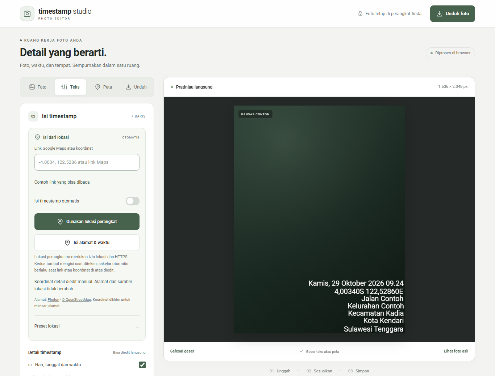
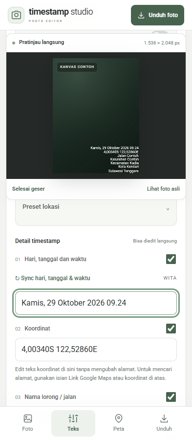

<div align="center">

# Timestamp Studio

Tambahkan waktu, alamat, dan peta pada foto — langsung dari browser.


[](https://github.com/andikapramudyadika/Timestamp-Studio/actions/workflows/checks.yml)


[**Buka aplikasi**](https://andikapramudyadika.github.io/Timestamp-Studio/) · [Panduan penggunaan](docs/GETTING_STARTED.md) · [Riwayat versi](CHANGELOG.md) · [Laporkan masalah](https://github.com/andikapramudyadika/Timestamp-Studio/issues)

</div>

Timestamp Studio adalah editor foto berbahasa Indonesia untuk desktop dan ponsel. Susun tujuh baris timestamp, sesuaikan tampilannya, tambahkan peta, lalu unduh foto dalam JPG atau PNG. Pemrosesan foto berlangsung di perangkat Anda; aplikasi menggunakan HTML, CSS, dan JavaScript tanpa framework, backend, atau langkah build.



<details>
<summary>Lihat tampilan ponsel</summary>
<br>

</details>

## Fitur utama

| Fitur | Kegunaan |
| --- | --- |
| Lokasi perangkat | Ambil posisi saat ini setelah memberikan izin, lalu isi koordinat dan detail alamat yang tersedia. |
| Google Maps dan koordinat | Tempel URL lengkap berkoordinat atau pasangan lintang/bujur untuk mencari alamat. |
| Waktu WITA | Sinkronkan hari, tanggal, dan waktu sekali tekan; seluruh teks tetap dapat diedit. |
| Preset lokasi | Simpan beberapa lokasi bernama, gunakan kembali, perbarui, atau hapus secara lokal. |
| Tampilan timestamp | Atur font, ukuran, ketebalan, warna, jarak, posisi, dan visibilitas setiap baris. |
| Peta pada foto | Unggah gambar peta, potong peta dari foto Timestamp asli, atau gunakan penyedia peta online. |
| Ekspor JPG/PNG | Pilih resolusi asli atau 2448 × 3264 piksel, dengan pilihan foto utuh atau potong tengah. |

## Mulai menggunakan

1. Buka [aplikasi](https://andikapramudyadika.github.io/Timestamp-Studio/), lalu unggah foto pada **Foto**. Kanvas contoh tersedia untuk mencoba editor.
2. Buka **Teks**. Pilih **Gunakan lokasi perangkat**, tempel sumber Maps/koordinat, atau isi detail secara manual. Periksa alamat yang dihasilkan.
3. Jika diperlukan, tambahkan gambar pada **Peta** dan sesuaikan ukuran serta posisinya.
4. Buka **Unduh**, pilih format dan resolusi, lalu simpan hasilnya. Foto asli tidak ditimpa.

### Lokasi dan waktu

- **Gunakan lokasi perangkat** mengambil posisi saat tombol ditekan. Fitur ini memerlukan HTTPS atau localhost, izin lokasi browser, dan layanan lokasi perangkat. Perkiraan akurasi ditampilkan. Posisi saat ini dapat berbeda dari lokasi pengambilan foto lama.
- Saat **Isi timestamp otomatis** dicentang, mengedit **Link Google Maps atau koordinat** memicu pengisian setelah masukan valid. Matikan sakelar untuk mengisi sendiri; kedua tombol pengisian tetap dapat digunakan secara eksplisit.
- Mengedit koordinat di **Detail timestamp** hanya mengubah teks koordinat dan membatalkan pencarian alamat yang masih berjalan. Alamat serta isian sumber Maps tetap dipertahankan.
- Tombol **Sync hari, tanggal & waktu** berada tepat di atas isian waktu. Waktu memakai **WITA (UTC+8)**, diisi satu kali, lalu bebas diedit. Tidak ada timer yang menimpa waktu manual atau perpindahan zona waktu otomatis.
- Nilai awal kota adalah **Kota Kendari** dan provinsi **Sulawesi Tenggara**. Hasil pencarian lokasi menggantikan nilai awal tersebut. Nama kecamatan memakai awalan **Kecamatan**, misalnya **Kecamatan Kadia**; nama yang belum diketahui tidak ditebak.

### Contoh masukan Google Maps

Salin salah satu format berikut ke isian sumber lokasi:

```text
https://www.google.com/maps/search/?api=1&query=-4.0034,122.5286
https://www.google.com/maps/@-4.0034,122.5286,17z
https://maps.google.com/?q=-4.0034,122.5286
-4.0034, 122.5286
```

URL lengkap dengan `q`, `query`, `ll`, `destination`, `@lat,lon`, atau pin `!3d…!4d…` didukung. Posisi pin didahulukan dari pusat tampilan peta; pada URL `@lat,lon`, koordinat menunjukkan pusat tampilan.

**Tautan pendek** `maps.app.goo.gl` dan `goo.gl/maps` perlu dibuka terlebih dahulu. Salin URL lengkap yang memuat koordinat atau koordinat titiknya. Aplikasi tetap statis dan tidak menggunakan backend/proxy untuk membuka redirect Google. URL yang hanya berisi nama tempat atau Place ID belum dapat dibaca.

### Menyimpan beberapa lokasi

Buka **Teks → Isi dari lokasi → Preset lokasi** setelah detail alamat sudah benar.

1. Beri nama lokasi, misalnya **Rumah** atau **Kantor**, lalu tekan **Simpan lokasi saat ini**.
2. Pilih lokasi tersimpan dan tekan **Gunakan** untuk memuatnya.
3. Untuk memperbarui, gunakan nama yang sama lalu tekan **Perbarui lokasi tersimpan**. Gunakan nama berbeda untuk membuat preset baru.
4. Tekan **Hapus** untuk menghapus preset terpilih. Detail yang sedang digunakan tetap ada.

Preset lokasi menyimpan enam baris koordinat/alamat dan sumber Maps. Memuatnya mempertahankan waktu serta tidak mencari alamat ulang. Preset tersimpan di browser dan domain yang sama, bukan di akun GitHub; membersihkan data situs akan menghapusnya. Fitur **Simpan/Muat pengaturan** tetap tersedia terpisah untuk teks dan tampilan editor.

### Pilihan peta

| Pilihan | Persyaratan |
| --- | --- |
| **Gambar peta** | Unggah peta yang sudah dipotong, beserta logo dan atribusi sumber. |
| **Foto Timestamp asli** | Unggah foto dengan peta persegi di kiri bawah. Periksa crop otomatis; tersedia penyesuaian ukuran dan jarak. |
| **OpenStreetMap** | Internet; tidak memerlukan API key. |
| **Google Maps online** | Internet, API key Google, Map Tiles API, dan billing aktif. Lihat [panduan Google Maps](docs/GOOGLE_MAPS.md). |

Crop unggahan dilakukan lokal pada piksel asli. Label dan logo tidak dihapus. Atribusi penyedia peta online ikut disimpan pada hasil foto.

## Privasi dan penyimpanan

Foto, peta unggahan, dan font unggahan diproses lokal serta tidak dikirim ke layanan alamat atau peta. Mengedit dan mengekspor foto dilakukan di browser; pencarian alamat dan peta online memerlukan internet.

| Data | Penggunaan |
| --- | --- |
| Koordinat lokasi | Dikirim ke [Photon](https://github.com/komoot/photon) saat meminta alamat. |
| Permintaan peta online | Dikirim ke Google Maps atau OpenStreetMap sesuai pilihan penyedia. |
| API key Google | Dipakai untuk permintaan Google Maps selama halaman terbuka; tidak dimasukkan ke preset. |
| Preset lokasi dan pengaturan | Disimpan dalam penyimpanan browser lokal; foto, gambar peta, dan font unggahan tidak ikut disimpan. |

Alamat Photon menggunakan data OpenStreetMap dan dapat berbeda dari Google Maps. Kelengkapan jalan, kelurahan, serta kecamatan bergantung pada data wilayah. Periksa hasil dan lengkapi kolom yang kosong. Jika layanan gagal, seluruh kolom tetap dapat diedit manual.

## Menjalankan secara lokal

Tidak perlu menginstal dependensi untuk menjalankan aplikasi. Dari folder proyek, gunakan server statis, misalnya:

```sh
python -m http.server 8000
```

Buka `http://localhost:8000`. Gunakan server lokal alih-alih membuka `index.html` melalui `file://`, karena aplikasi memakai modul JavaScript. Untuk lokasi perangkat di luar localhost, gunakan HTTPS.

## Deployment GitHub Pages

1. Letakkan seluruh berkas aplikasi di root repository, termasuk `location-presets.js`, folder `fonts/`, dan `.nojekyll`.
2. Pada **Settings → Pages**, pilih **Deploy from a branch**, branch **main**, folder **/(root)**.
3. Setelah deployment selesai, buka URL Pages dan pastikan footer menampilkan **v1.7.1**.

Semua aset memakai jalur relatif sehingga aplikasi mendukung URL subfolder repository. Tidak ada build server atau backend tambahan. Untuk memperbarui instalasi lama, ikuti [petunjuk pembaruan](PEMBARUAN.md).

## Pengembangan dan pengujian

Gunakan Node.js **22 atau lebih baru** untuk menjalankan unit test:

```sh
npm test
```

GitHub Actions memeriksa sintaks seluruh modul aplikasi dan menjalankan unit test. Pengujian browser opsional tersedia melalui `npm run test:browser` setelah Playwright dan Chromium tersedia; `PLAYWRIGHT_MODULE_PATH` dan `CHROME_PATH` dapat digunakan untuk instalasi yang sudah ada.

Verifikasi lokal v1.7.1 mencatat **35 unit test lulus**, pemeriksaan browser pada **360, 393, 430, dan 1366 CSS px**, serta ekspor JPG/PNG. Pengujian lokasi menggunakan emulasi browser dan fixture alamat; GPS fisik Android/iOS belum diverifikasi. Lihat [laporan verifikasi](docs/VERIFICATION-v1.7.1.md) untuk cakupan dan batas pengujian.

| Bagian | Berkas |
| --- | --- |
| Antarmuka dan state editor | `index.html`, `style.css`, `mobile.css`, `app.js` |
| Render dan ekspor | `renderer.js` |
| Koordinat dan peta online | `maps.js` |
| Alamat dan lokasi perangkat | `location.js` |
| Preset lokasi | `location-presets.js` |
| Crop peta lokal | `map-crop.js` |
| Pengujian | `tests/`, `scripts/check-browser.cjs`, `scripts/check-locations.cjs` |

## Dokumentasi

- [Panduan penggunaan](docs/GETTING_STARTED.md)
- [Petunjuk pembaruan](PEMBARUAN.md)
- [Google Maps dan API key](docs/GOOGLE_MAPS.md)
- [Riwayat pembaruan](CHANGELOG.md)
- [Aturan desain](DESIGN.md) dan [kontribusi](CONTRIBUTING.md)
- [Kalibrasi tampilan](KALIBRASI.md)
- [Catatan pihak ketiga](THIRD_PARTY_NOTICES.md)

Untuk melaporkan masalah, sertakan versi aplikasi, browser/perangkat, langkah reproduksi, dan hasil yang diharapkan melalui [GitHub Issues](https://github.com/andikapramudyadika/Timestamp-Studio/issues). Gunakan gambar contoh yang aman dibagikan dan hapus API key atau informasi pribadi dari laporan.
