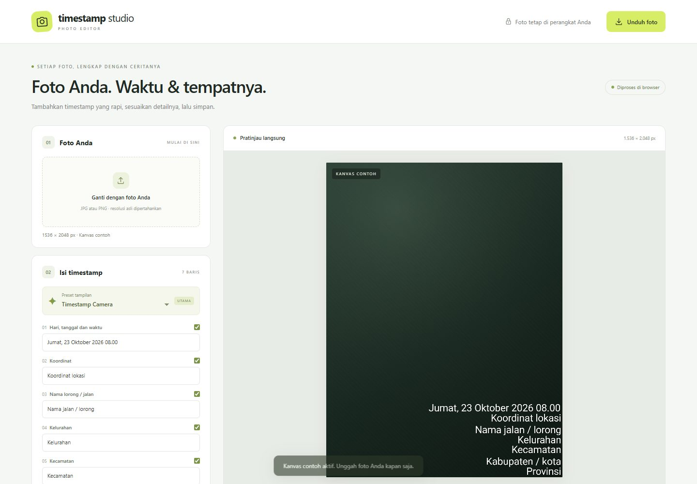
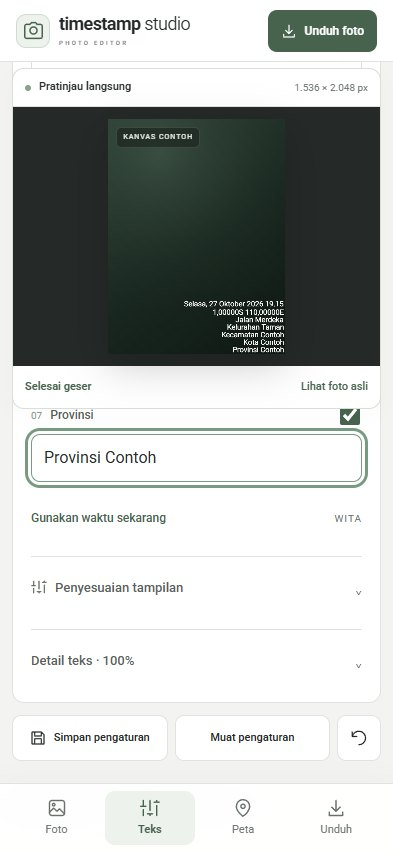
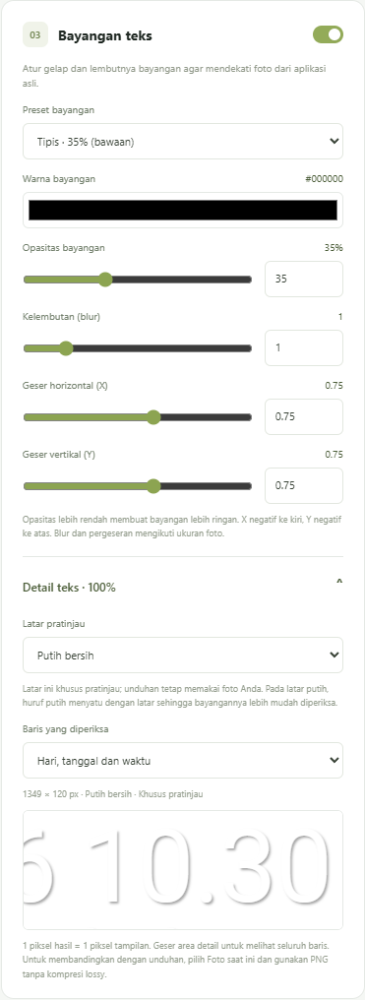
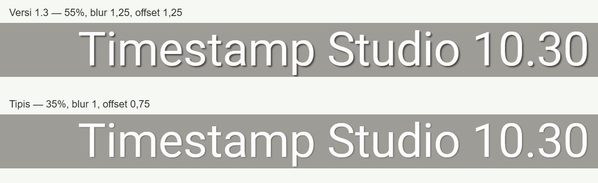

  
  <h1>Timestamp Studio</h1>
  
Editor timestamp foto dengan peta lokasi dan ekspor resolusi penuh.

  

    
    
    
    
  

  
<a href="https://andikapramudyadika.github.io/Timestamp-Studio/"><strong>Buka aplikasi</strong></a> · <a href="docs/GETTING_STARTED.md">Panduan penggunaan</a> · <a href="CHANGELOG.md">Riwayat pembaruan</a> · <a href="https://github.com/andikapramudyadika/Timestamp-Studio/issues">Laporkan masalah</a>

**Versi saat ini: v1.5.0.** Panel bayangan memiliki slider dan input angka, pilihan warna, serta detail teks 100%. Bawaan **Berlapis** menambahkan inti tegas dan bayangan luar lembut; preset **Versi 1.3 · 55%** tetap tersedia. Lihat [CHANGELOG.md](CHANGELOG.md).

## Fitur

| Area | Kemampuan |
| --- | --- |
| Timestamp | Tujuh baris dengan sakelar masing-masing; waktu otomatis WITA |
| Tipografi | Roboto variabel lokal, ketebalan 250–500, warna, ukuran, jarak, margin, serta font unggahan |
| Bayangan | Preset Berlapis, Acuan DEX, Tipis, versi 1.3, PixelLab, dan APK lama; warna, opasitas, blur, serta offset dengan slider/input angka |
| Peta | Google Maps resmi, OpenStreetMap, atau gambar peta unggahan |
| Pratinjau | Perubahan langsung, detail teks 100% per baris, geser objek, dan pembandingan foto asli |
| Ekspor | JPG/PNG; resolusi asli atau 2448 × 3264; foto utuh atau potong tengah |
| Preset | Simpan teks dan pengaturan di browser melalui localStorage |
| Ponsel | Navigasi Foto · Teks · Peta · Unduh dan kontrol sentuh |

Pratinjau tampilan ponsel

Editor foto berbahasa Indonesia untuk tujuh baris timestamp dan peta. Foto diproses di browser, dengan unduhan JPG/PNG pada resolusi asli atau 2448 × 3264. Aplikasi statis ini dapat dijalankan di GitHub Pages tanpa build, npm install, atau backend.

Versi 1.4 menyediakan penyesuaian bayangan yang lebih presisi. Font, ukuran, susunan teks, dan peta dipertahankan.

## Menjalankan di GitHub Pages

1. Buat repository GitHub. Untuk GitHub Free, gunakan repository Public agar dapat memakai Pages.
2. Ekstrak ZIP, lalu unggah **isi folder** `timestamp-studio-github` ke halaman utama repository melalui **Add file → Upload files**. Jangan unggah ZIP sebagai satu berkas.
3. Pastikan `index.html`, `app.js`, `renderer.js`, `maps.js`, `style.css`, `mobile.css`, `icon.svg`, `.nojekyll`, dan folder `fonts/` berada langsung di root repository.
4. Buka **Settings → Pages → Deploy from a branch → main → /(root) → Save**. Gunakan nama branch Anda jika berbeda.
5. Buka alamat Pages setelah penerbitan selesai. Footer menampilkan **timestamp studio v1.5.0**.

Untuk memperbarui aplikasi lama, lihat [PEMBARUAN.md](PEMBARUAN.md). Semua aset memakai jalur relatif sehingga mendukung alamat Pages dengan subfolder repository.

## Bayangan tulisan

Buka panel **Bayangan teks** (tab **Teks** pada ponsel). Bawaan **Berlapis** memakai inti hitam 30% tanpa blur, offset 0,85/0,85; di belakangnya bayangan hitam 25%, radius Android 2, offset 1/1 pada acuan sisi panjang 1280. Preset **Acuan DEX** memakai satu bayangan dengan konversi blur dan alpha setengah teks. Ini titik awal; belum dikalibrasi ulang terhadap foto asli pengguna.
- Pilih warna bayangan, termasuk abu-abu gelap untuk hasil yang lebih ringan.
- Atur opasitas 0–100%, blur 0–6, dan offset X/Y −5 sampai 5. Blur dan offset memiliki langkah 0,05; tersedia slider dan input angka.
- Pilih **Versi 1.3 · 55%** untuk membandingkan tampilan sebelumnya. Preset PixelLab dan APK tetap tersedia. Memilih preset hanya mengganti bayangan.
- Buka **Detail teks · 100%**, pilih latar dan baris, lalu geser area detail. Bawaan **Putih bersih (#FFFFFF)** membantu memeriksa bayangan; huruf putih menyatu dengan latar. **Abu-abu terang (#E5E7EB)** memperjelas huruf sekaligus bayangannya. **Foto saat ini** menampilkan area foto seperti hasil unduhan.
- Pilihan latar hanya memengaruhi detail pemeriksaan; pratinjau foto utama dan unduhan tetap memakai foto Anda. Skala teks/bayangan tetap 100% dan mengikuti resolusi ekspor. Untuk membandingkan langsung dengan unduhan, pilih **Foto saat ini** dan format PNG.
- **Simpan preset** menyimpan warna dan seluruh pengaturan bayangan bersama teks. Preset lama tetap memakai nilainya sendiri; warna yang belum tersimpan memakai hitam. **Reset pengaturan** kembali ke bawaan Berlapis.

Gambar berikut menunjukkan antarmuka dan perbandingan versi 1.4 sebelum mode Berlapis.

## Google Maps

Google Maps menjadi pilihan sumber peta utama. Peta dimuat langsung melalui **Map Tiles API resmi**, menggunakan roadmap, bahasa Indonesia, label beresolusi tinggi, dan pin merah dengan ujung pada koordinat. Ini bukan peta OpenStreetMap yang diganti warnanya. Gaya/label Google dapat berubah dan tidak dijamin identik dengan versi Google Maps pada foto lama.

1. Di Google Cloud, buat/pilih project, aktifkan billing, lalu aktifkan **Map Tiles API**.
2. Buat API key. Batasi key ke **Map Tiles API** dan alamat situs Anda melalui **Websites / HTTP referrers**, misalnya `https://andikapramudyadika.github.io/*`. Untuk pengujian lokal, tambahkan `http://127.0.0.1:8013/*` bila diperlukan. Atur kuota penggunaan di Google Cloud.
3. Buka bagian **Peta**, pilih **Google Maps**, lalu masukkan key pada kolom aplikasi. Tidak perlu mengirim key lewat chat atau menulisnya di repository.
4. Tempel koordinat `lintang, bujur`, lalu tekan **Buat peta**, atau biarkan pilihan otomatis aktif. Pengambilan peta memakai kuota dan dapat menimbulkan biaya sesuai akun Google Cloud Anda.
5. Tunggu **Peta Google Maps siap**, lalu unduh foto. Nama Google Maps dan atribusi data yang diberikan Google ikut digambar pada hasil dengan opasitas penuh.

Key hanya digunakan selama halaman terbuka, dikirim ke Google untuk autentikasi, dan tidak dimasukkan dalam localStorage/preset. Key aplikasi browser terlihat pada permintaan jaringan; pembatasan domain dan API perlu dikonfigurasi di Google Cloud. Token sesi hanya disimpan di memori. Aplikasi tidak membuat cache tile Google sendiri; cache HTTP mengikuti respons Google.

Tanpa API key, **unggah gambar Google Maps Anda** melalui **Unggah gambar peta**; sertakan logo/atribusi dalam gambar. Anda juga dapat memilih **OpenStreetMap · gratis, tanpa API key**. Aplikasi tidak berpindah ke OpenStreetMap secara diam-diam bila Google gagal. Pesan kesalahan menjelaskan bila key, billing, izin domain, atau kuota perlu diperiksa.

Panduan resmi:

- [Map Tiles API: API key](https://developers.google.com/maps/documentation/tile/get-api-key)
- [Roadmap tiles](https://developers.google.com/maps/documentation/tile/roadmap)
- [Penggunaan dan billing](https://developers.google.com/maps/documentation/tile/usage-and-billing)
- [Atribusi Google Maps](https://developers.google.com/maps/documentation/tile/policies)

## Pemakaian dan privasi

Unggah foto JPG, PNG, atau WebP; isi waktu dan lokasi; atur peta; lalu unduh JPG/PNG. Waktu otomatis menggunakan WITA. Navigasi bawah **Foto · Teks · Peta · Unduh** tersedia di ponsel. Aktifkan **Geser objek** bila ingin memindahkan teks/peta.

Foto, font, dan gambar peta unggahan diproses di browser. Saat meminta peta otomatis, penyedia yang dipilih menerima permintaan untuk area koordinat tersebut; foto Anda tidak dikirim. OpenStreetMap memakai `tile.openstreetmap.org` dan atribusinya ikut diekspor. Peta otomatis memerlukan internet.

**Simpan preset** menyimpan teks dan pengaturan tampilan pada localStorage perangkat ini. Foto, gambar peta, font unggahan, dan API key tidak disimpan. Jangan unggah foto pribadi atau API key ke repository publik. Berkas pribadi dan foto referensi tidak disertakan dalam paket aplikasi.

Font Roboto variabel disertakan di `fonts/` bersama lisensinya. Pengaturan ketebalan huruf menyediakan 250–500, dengan bawaan 380.

## Pemeriksaan lokal

Gunakan Node.js 22 atau lebih baru. Tidak perlu `npm install`: tidak ada dependensi npm. [GitHub Actions](https://github.com/andikapramudyadika/Timestamp-Studio/actions/workflows/checks.yml) menjalankan pemeriksaan sintaks dan 25 pengujian pada push/pull request. Alur Google telah diperiksa dengan respons simulasi; akses Google sebenarnya tetap memerlukan key dan billing aktif.

Jalankan `node --test tests/*.test.mjs` untuk memeriksa koordinat, viewport, pesan kesalahan Google, waktu WITA, susunan teks, atribusi, serta skala bayangan.

Untuk menjalankan aplikasi, sajikan folder ini dengan server statis, misalnya `python -m http.server 8000`, lalu buka `http://localhost:8000`. Jangan hanya klik ganda `index.html` karena browser dapat memblokir modul JavaScript pada URL berkas.

## Dokumentasi dan kontribusi

| Dokumen | Isi |
| --- | --- |
| [Panduan penggunaan](docs/GETTING_STARTED.md) | Alur editor, peta, ekspor, preset, dan pemecahan masalah |
| [Google Maps](docs/GOOGLE_MAPS.md) | API key, pembatasan domain, kuota, dan alternatif |
| [Pengembangan](docs/DEVELOPMENT.md) | Struktur source dan pemeriksaan lokal/browser |
| [Changelog](CHANGELOG.md) | Riwayat fitur v1.0–v1.5 |
| [Kalibrasi](KALIBRASI.md) | Metode pengukuran dan batas interpretasi |
| [Kontribusi](CONTRIBUTING.md) | Laporan bug dan pull request |
| [Aset pihak ketiga](THIRD_PARTY_NOTICES.md) | Font, lisensi, dan sumber peta |

Dikelola oleh [Andika Pramudya](https://github.com/andikapramudyadika). Lisensi font disertakan di `fonts/`; repository belum menetapkan lisensi distribusi terbuka untuk kode aplikasi. Gambar dokumentasi menggunakan kanvas contoh dan tidak menyertakan foto pribadi atau API key.

### Bayangan v1.5.0

Pilih **Berlapis** (bawaan) untuk inti tegas + bayangan luar lembut, atau **Acuan DEX** untuk model satu bayangan Android. Sesuaikan inti melalui bagian **Inti bayangan · tegas** dan periksa lewat **Detail teks · 100%**. Preset lama tetap tersedia; lihat [kalibrasi](KALIBRASI.md) untuk parameter dan batas kesesuaian.
